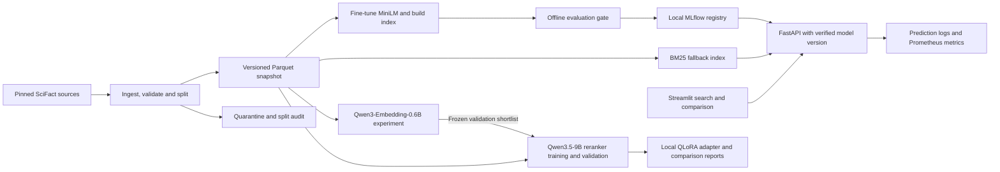

# SemanticSearch AI

Search and rank scientific abstracts from the BEIR SciFact corpus. The local app lets you compare dense retrieval with BM25 and keyword overlap, inspect abstracts, and trace served results to the model and data version.

## Problem framing

| | |
|---|---|
| Business goal | Reduce the time researchers spend finding papers relevant to a claim. |
| Decision | Which papers should a researcher read first? |
| Input and output | A natural-language claim or search query in, the top-`k` ranked abstracts with document IDs and scores out. |
| ML task | Rank abstracts by relevance using a dual encoder trained on judged claim–paper pairs. |
| Baseline | Deterministic keyword overlap, with TF-IDF and BM25 as stronger lexical comparisons. |
| Success measures | Validation nDCG@10 and Recall@5 for ranking quality. Warm API p95 latency target of 500 ms under at least five concurrent clients. |

The search results support literature review. Assessing whether a paper supports or refutes a claim requires reading the evidence.

## Architecture



## Run locally

For the complete local demo, install Python 3.12 or newer, `uv`, `make`, Prometheus, and Grafana, then run from a Git checkout:

```sh
make demo
```

The command downloads pinned SciFact inputs, validates and prepares them, trains MiniLM, applies the evaluation gate, registers and exports the release, and starts the API, quality sentinel, Prometheus, and Grafana. It verifies a dense search, a successful labeled replay, both scrape targets, and the provisioned dashboard before printing the URLs. The dashboard allows anonymous viewing on localhost. Press Ctrl+C to stop the demo services. Run `make demo DEMO_ARGS='--check'` to verify the chain and stop automatically.

Each run starts with a separate demo registry and compares against BM25 and frozen MiniLM. Its registry, exported release, and logs stay under `artifacts/models/demo/run-*`. The first run needs network access for dependencies, SciFact, and model weights. The launcher finds Homebrew Grafana automatically. For other installations, set `DEMO_ARGS='--grafana-home /usr/share/grafana'`. Override occupied ports with `--api-port`, `--quality-port`, `--prometheus-port`, and `--grafana-port`. A rejected model or failed startup stops the demo and reports a failure.

To run the data and training stages separately, use these commands from the project root.

```sh
make ingest && make prepare && make pipeline
```

`make prepare` writes a versioned snapshot with partitioned queries and judgments. `make pipeline` fine-tunes MiniLM, builds its index, evaluates the saved bundle, and registers it in local MLflow if it passes the gate.

When updating a running service, evaluate against its loaded model with `make pipeline PIPELINE_ARGS='--champion-api-url http://127.0.0.1:8000'`. The gate verifies that release against the registry and records the comparison model in MLflow.

Set `SCIFACT_MODEL_VERSION` to the `registered_version` printed by your pipeline run. For example, if it prints `3`, start the API with:

```sh
SCIFACT_MODEL_VERSION=3
make serve SERVE_ARGS="--model-version $SCIFACT_MODEL_VERSION"
```

In a second terminal in the same directory, run `make ui` and open [SciFact Search](http://127.0.0.1:8501). Try **exercise and heart health** in compare mode. The [API playground](http://127.0.0.1:8000/docs) is also available.

To serve a registered model from a local container, see [Run the API in Docker](docs/serving.md#run-the-api-in-docker).

Each checkout has its own local registry by default. If an API is already running on port 8000, check [readiness](http://127.0.0.1:8000/health/ready) and [model metadata](http://127.0.0.1:8000/api/v1/models) to identify it. To start your API on port 8001, use:

```sh
make serve SERVE_ARGS="--model-version $SCIFACT_MODEL_VERSION --port 8001"
```

In the UI terminal, point Streamlit at the new port:

```sh
SCIFACT_API_URL=http://127.0.0.1:8001 make ui
```

If API startup reports a missing training Git commit, run `make pipeline` from a Git checkout and serve the version it registers. See the [serving guide](docs/serving.md).

## Fine-tune Qwen3.5-9B and watch training

`make train-qwen` uses the **Qwen3.5-9B MLX 4-bit** checkpoint downloaded in LM Studio. It runs on Apple Silicon with MLX and freezes the 4-bit base weights. It trains **139,264 parameters** in rank-8 adapters on the last attention block’s query and value projections. This is **QLoRA**.

The 9B model reranks shortlisted papers. BM25 retrieves candidate abstracts, then Qwen scores each claim–paper pair from the relative likelihood of `yes` and `no`. Training uses judged relevant papers and BM25 hard negatives that lack positive judgments. Those negatives can include relevant papers missed by the annotations. The default run performs 100 optimizer steps with AdamW at `5e-5`.

The default checkpoint directory is `~/.lmstudio/models/lmstudio-community/Qwen3.5-9B-MLX-4bit`. Pass `--model` in `QWEN_ARGS` if LM Studio stores the checkpoint elsewhere.

With a prepared SciFact snapshot, you can first check that training works with two optimizer steps:

```sh
make train-qwen QWEN_ARGS='--max-steps 2'
```

For the default training run, run:

```sh
time make train-qwen
```

To use the step budget from the measured run below, train for two full epochs:

```sh
make train-qwen QWEN_ARGS='--epochs 2'
```

On the current SciFact snapshot, one full epoch is 1,478 optimizer steps. Each step uses one example, and every training group contains a judged relevant paper and a BM25 hard negative. The default 100-step run covers part of an epoch. Choose either `--epochs` or `--max-steps`.

Watch the terminal for the epoch number, step within that epoch, and current loss. At each epoch boundary, the trainer prints the mean training loss. A step-limited run also prints a summary for any partial epoch. The final adapter manifest under `artifacts/models/qwen-9b-qlora/` saves these summaries in `epoch_history`. Use validation ranking metrics to judge whether the adapter improved retrieval.

To display and save the two-epoch training log, including total elapsed time, use this command in Bash or Zsh:

```bash
(
  set -o pipefail
  mkdir -p artifacts/models/qwen-9b-qlora || exit 1
  { time make train-qwen QWEN_ARGS='--epochs 2'; } 2>&1 |
    tee "artifacts/models/qwen-9b-qlora/train-$(date +%Y%m%d-%H%M%S).log"
)
```

Paste the manifest path from the full run into evaluation:

```sh
make evaluate-qwen QWEN_ARGS='--run artifacts/models/qwen-9b-qlora/REPLACE_WITH_RUN_ID/manifest.json'
```

Evaluation compares BM25, frozen Qwen3.5-9B, and adapted Qwen3.5-9B using the same shortlist for each claim. It writes `comparison-validation.json` and per-query reports beside the manifest. Add `--query-limit 1` for a quick verification or `--top-n 20` to rerank a deeper shortlist. At the default depth of 10, reranking can change nDCG@10 and Recall@5, while Recall@10 is fixed by the candidate set.

To test 0.6B embedding retrieval followed by 9B reranking, pass the saved embedding validation report as the candidate source:

```sh
SCIFACT_RUN=artifacts/models/qwen-9b-qlora/REPLACE_WITH_RUN_ID/manifest.json
SCIFACT_CANDIDATES=artifacts/evaluation/qwen3-embedding-0.6b/qwen-validation.json
make evaluate-qwen QWEN_ARGS="--run $SCIFACT_RUN --candidate-report $SCIFACT_CANDIDATES --query-limit 5"
```

The comparison reports the original embedding rankings under `qwen_embedding` and the same papers reranked by your adapter under `qlora_qwen`. Omit `--query-limit 5` for all 162 validation claims. The complete hybrid report is saved as `comparison-qwen-embedding-validation.json` next to the adapter manifest. If the frozen embedding report is missing, the [embedding evaluation workflow](docs/evaluation.md#fine-tune-the-qwen-embedding-model-with-lora) can generate it at the default path.

The adapted 9B model was trained for two epochs and evaluated on BM25 shortlists across the full validation split. The hybrid workflow has a one-claim smoke check. The search API serves the registered MiniLM bundle. The **Qwen3-Embedding-0.6B** LoRA experiment runs through `make train-qwen-embedding` and `make evaluate-qwen-embedding`.

Full evaluations record an offline gate in the comparison report and exit with status `2` when the reranker falls below its metric floors. The BM25 workflow compares against BM25 and frozen Qwen3.5-9B. The hybrid workflow compares against embedding retrieval alone. Runs with `--query-limit` skip the gate.

## Measured results

All methods used the same 162 validation claims and 5,183-abstract corpus. The 9B models scored papers shortlisted by BM25.

| Retriever | nDCG@10 | Recall@5 |
|---|---:|---:|
| Keyword overlap | 0.4902 | 0.5190 |
| TF-IDF | 0.5985 | 0.6600 |
| BM25 | 0.6570 | 0.6960 |
| Frozen MiniLM | 0.6762 | 0.7623 |
| Fine-tuned MiniLM | 0.7017 | 0.7716 |
| Frozen Qwen3-Embedding-0.6B | 0.7370 | 0.8210 |
| BM25 + frozen Qwen3.5-9B reranker | 0.6763 | 0.7377 |
| BM25 + QLoRA Qwen3.5-9B reranker | 0.6986 | 0.7438 |

On the separate **300-query official test**, selected MiniLM version 3 reached **0.6661 nDCG@10**, compared with **0.6451** for frozen MiniLM and **0.6617** for BM25. Excluding 18 overlap-flagged test claims reduced its score to **0.6532**, below BM25's **0.6568**. Fine-tuning improved MiniLM; a clear overall advantage over BM25 is unproven. Run `make test-benchmark TEST_BENCHMARK_ARGS='--model-version 3'` for that registered version, or select your own registry version before inspecting test scores. [Test protocol, full metrics, and lineage](docs/evaluation.md#official-test-results)

MiniLM serving reached **25.3 ms warm server-side p95** on loopback across 150 requests and five concurrent clients on the Apple M4 Pro. A local fault-injection drill killed the dense worker, triggered BM25 fallback, and kept the API live. An API restart restores dense inference. [Serving benchmark and drill](docs/serving.md#local-verification)

## Verification and limitations

GitHub Actions checks lint, formatting, types, and the test suite on pull requests and pushes to `main`. A separate job builds the API image and checks its entrypoint, non-root user, and CPU dependencies.

Run the Python checks locally:

```sh
uv sync --locked --extra dense --extra registry --extra serving --extra ui
uv run --locked --no-sync ruff check src tests
uv run --locked --no-sync ruff format --check src tests
uv run --locked --no-sync mypy
MLFLOW_DISABLE_TELEMETRY=true HF_HUB_OFFLINE=1 \
  uv run --locked --no-sync python -m unittest discover -s tests
```

- SciFact judgments cover a subset of relevant papers. In-batch negatives can include useful papers that lack a relevance judgment.
- The split audit flags 18 official test claims with development overlap. Separate test results and an overlap-filtered sensitivity check are reported above; future test-informed tuning needs a fresh holdout.
- Both embedding evaluations used a 256-token cap, which can truncate long abstracts.
- Retrieval and fault-injection results are local measurements. A two-model local drill verified isolated shadow inference plus atomic promotion and rollback pointers. Researcher time savings, supervisor-driven restart, and cloud deployment remain unverified. The [serving guide](docs/serving.md#shadow-release-and-rollback) documents the release workflow and evidence, and the [monitoring guide](docs/monitoring.md) covers local service health, retrieval-quality replay, query-length drift, and recovery drills.

For more detail, see the [MiniLM model card](docs/model-card.md), [system requirements](docs/requirements.md), [data contract](docs/data_contracts.md), [evaluation and training guide](docs/evaluation.md), and [serving guide](docs/serving.md).
