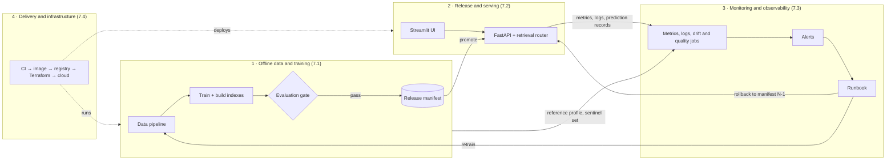
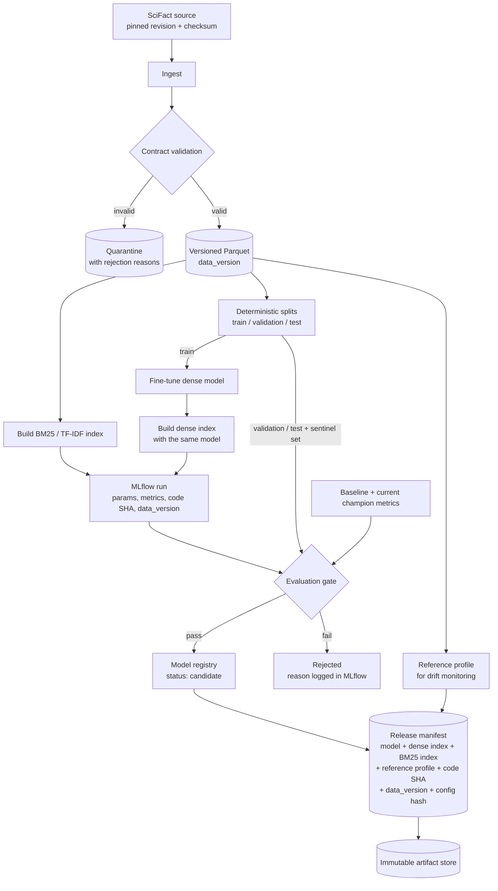
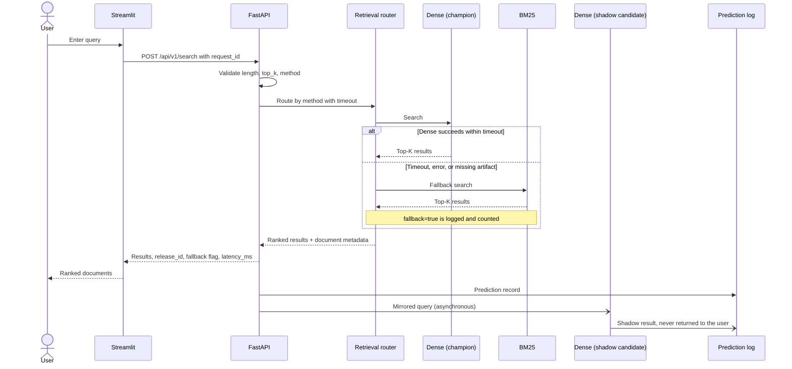
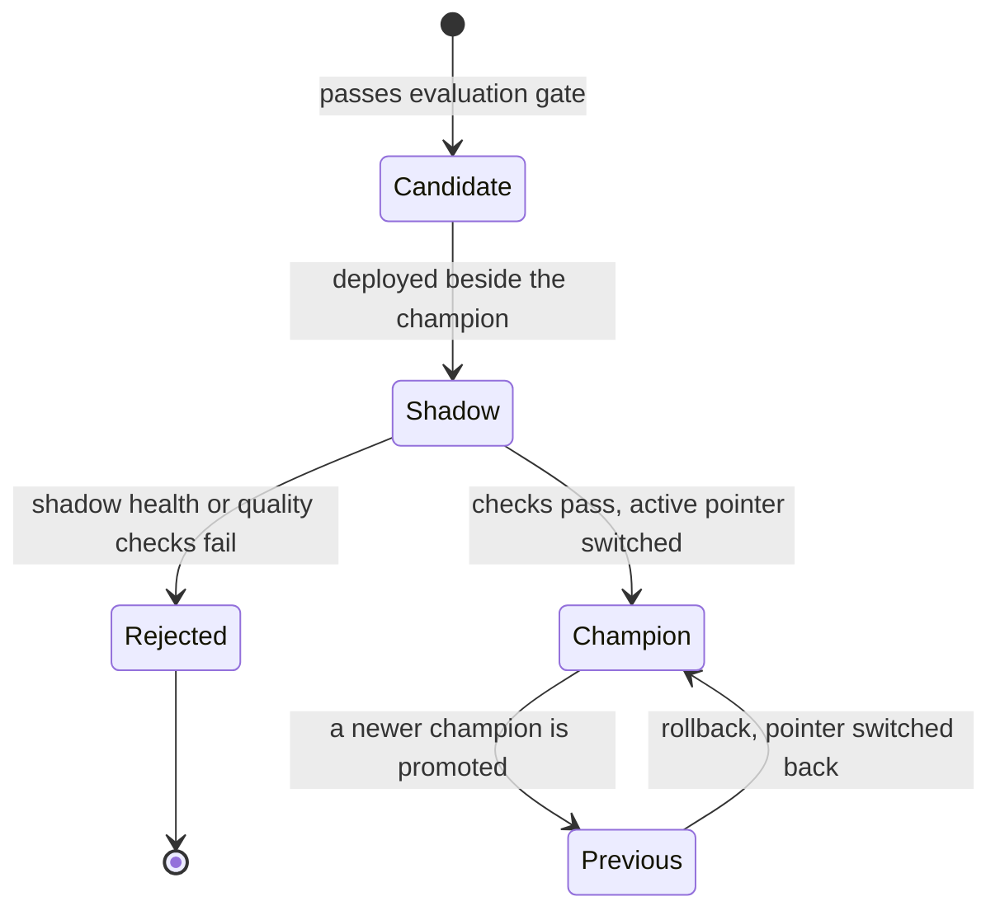
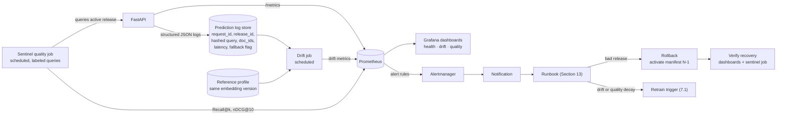
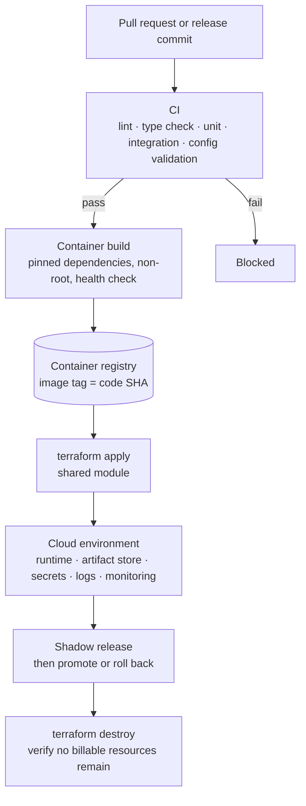

# SemanticSearch AI
## Production-Grade Scientific Evidence Retrieval Platform

**Software Requirements Specification & ML System Design**

| Property | Details |
|---|---|
| Document version | 2.0 |
| Status | Approved design baseline; implementation not started |
| Domain | NLP / Information Retrieval / MLOps |
| Project category | End-to-End ML Systems Engineering |
| Dataset | BEIR SciFact |
| Primary language | Python |
| ML framework | PyTorch |
| Deployment | Containerized cloud application |
| Architecture | Modular ML service with offline and online pipelines |

---

# 1. Executive Summary

SemanticSearch AI is an AI-powered scientific document retrieval system that enables researchers to discover relevant scientific evidence using natural-language queries.

The project will implement traditional keyword retrieval, classical information retrieval, pretrained neural embeddings, and a fine-tuned retrieval model.

Unlike a basic ML prototype, this system will cover the complete machine learning lifecycle:

1. Requirements and problem framing
2. Data engineering
3. Model training and experiment tracking
4. Model evaluation and promotion
5. Model serving
6. Production monitoring
7. Deployment and operations
8. Documentation and reproducibility

**Primary goal:** Engineer a measurable, reproducible, deployable ML retrieval platform.

**Business goal:** Explore whether semantic retrieval can reduce the effort researchers spend finding relevant scientific literature.

**Primary ML task:** Rank scientific abstracts by their relevance to a scientific claim.

**Important boundary:** Retrieving relevant evidence is not equivalent to determining whether a scientific claim is true.

---

# 2. Business Requirements and Product Model

## 2.1 Business Problem

Scientific literature often describes similar concepts using different terminology.

Traditional search tools may fail to retrieve relevant documents when the wording of a query differs from the wording of a scientific paper.

Researchers consequently spend time refining queries and reviewing potentially irrelevant results.

## 2.2 Proposed Solution

Build a semantic search platform that:

- Understands natural-language scientific queries.
- Retrieves potentially relevant scientific abstracts.
- Ranks documents using multiple retrieval strategies.
- Provides transparent links to source documents.
- Measures retrieval effectiveness and response latency.

## 2.3 Target Customers

| Customer | Potential value |
|---|---|
| Universities | Research discovery |
| Researchers | Faster literature exploration |
| Research laboratories | Finding relevant evidence |
| Scientific software companies | Retrieval API integration |
| Corporate R&D teams | Scientific knowledge discovery |

## 2.4 Business Decision

**Decision supported by the system:** Which scientific documents should a researcher examine first?

**Input:** Scientific claim or natural-language research query.

**Output:** Ranked list of relevant scientific abstracts.

**Human decision:** The researcher determines whether the retrieved evidence is scientifically meaningful.

## 2.5 Business Model Canvas

| Component | Proposed strategy |
|---|---|
| Customer segments | Research organizations and universities |
| Value proposition | Faster discovery of relevant evidence |
| Channels | Web platform and REST API |
| Customer relationships | Self-service and institutional contracts |
| Revenue streams | Subscriptions, API usage, enterprise licensing |
| Key resources | Retrieval models, indexed documents, engineering infrastructure |
| Key activities | Ingestion, training, retrieval, evaluation, operations |
| Key partners | Dataset and infrastructure providers |
| Cost structure | Compute, storage, inference, monitoring, development |

This is a proposed business model, not a validated commercial opportunity.

## 2.6 Business Success Metrics

| Metric | Purpose |
|---|---|
| Time to find relevant evidence | Measure user productivity |
| Search task completion rate | Measure usefulness |
| User-rated relevance | Collect direct relevance feedback |
| Cost per 1,000 searches | Measure operating efficiency |
| User retention | Future product validation |

**Business validation requirement:** Interview at least five potential users and conduct a small search-task comparison against their existing workflow.

No commercial revenue assumptions will be presented as verified facts.

---

# 3. Problem Framing and ML Task

## 3.1 Task Definition

**Task:** Scientific document retrieval and ranking.

**Learning paradigm:** Supervised representation learning during fine-tuning, combined with classical retrieval baselines.

**Input:** Query \(q\).

**Documents:** Corpus \(D=\{d_1,\ldots,d_n\}\).

**Output:** Top-K ranked documents.

The retrieval system estimates a relevance score:

\[
s(q,d_i)
\]

Documents are ranked by decreasing score.

## 3.2 Non-ML Baseline

Implement literal keyword search using SQLite FTS5 or an equivalent deterministic text search mechanism.

Its purpose is to establish whether ML-based retrieval adds measurable value over a simple search solution.

## 3.3 ML and Information Retrieval Baselines

- TF-IDF with cosine similarity
- BM25
- Pretrained dense embedding retrieval

## 3.4 Trainable Candidate

Fine-tune a Sentence Transformer using SciFact's training relevance judgments.

Compare the fine-tuned candidate against the current approved retrieval configuration.

## 3.5 Primary Evaluation Metric

**nDCG@10** — Ranking effectiveness.

Secondary metrics:

- Recall@5
- Recall@10
- MRR@10
- Query latency
- Memory usage
- Search cost

The training model must not be deployed solely because its training loss decreases.

---

# 4. Dataset Specification

## 4.1 Data Sources

**Primary dataset:** BEIR SciFact

https://huggingface.co/datasets/BeIR/scifact

**Relevance judgments:**

https://huggingface.co/datasets/BeIR/scifact-qrels

**Official retrieval tooling:**

https://github.com/beir-cellar/beir

**Original SciFact research:**

https://github.com/allenai/scifact

## 4.2 Dataset Characteristics

| Property | Value |
|---|---|
| Corpus | 5,183 scientific abstracts |
| Query collection | 1,109 queries |
| Official test queries | 300 |
| Training queries | Approximately 809 |
| Language | English |
| Document representation | Title and abstract |
| Supervision | Query-document relevance judgments |

Actual record counts and relationships must be validated during ingestion.

The BEIR distribution provides training and test relevance judgments but no separate standard development split.

## 4.3 Data Schema

**Document contract**

| Field | Type | Constraint |
|---|---|---|
| document_id | string | Required, unique |
| title | string | Empty allowed |
| text | string | Required, non-empty |
| dataset_version | string | Required |

**Query contract**

| Field | Type | Constraint |
|---|---|---|
| query_id | string | Required, unique |
| text | string | Required, non-empty |
| split | enum | train / validation / test |

**Relevance contract**

| Field | Type | Constraint |
|---|---|---|
| query_id | string | Must reference an existing query |
| document_id | string | Must reference an existing document |
| relevance | integer | Must meet the configured label policy |
| split | enum | train / validation / test |

## 4.4 Dataset Split Strategy

- Preserve the official test query set.
- Create a deterministic validation split from the training queries.
- Train only using the remaining training queries and labels.
- Tune configurations using validation data.
- Perform final benchmark evaluation on the official test set.

Audit near-duplicate or closely paraphrased claims across splits and document possible leakage risks.

Unjudged documents must not automatically be considered verified negatives.

## 4.5 Data Licensing

Record the dataset's published license, attribution requirements, source revisions, and redistribution restrictions.

The Hugging Face dataset listings identify CC BY-SA 4.0, but original content rights must also be reviewed before commercial use.

---

# 5. Functional Requirements

Functional requirements specify what the complete system must do.

## 5.1 Data Engineering

| ID | Requirement | Priority |
|---|---|---|
| FR-01 | Download source data reproducibly | Must |
| FR-02 | Validate records against documented contracts | Must |
| FR-03 | Quarantine invalid records with rejection reasons | Must |
| FR-04 | Produce versioned, partitioned datasets | Must |
| FR-05 | Guarantee deterministic, idempotent processing | Must |
| FR-06 | Track dataset versions and source checksums | Must |

## 5.2 Machine Learning

| ID | Requirement | Priority |
|---|---|---|
| FR-07 | Implement keyword, TF-IDF, and BM25 baselines | Must |
| FR-08 | Implement pretrained dense retrieval | Must |
| FR-09 | Fine-tune a retrieval model using training labels | Must |
| FR-10 | Track experiments and artifacts using MLflow | Must |
| FR-11 | Evaluate every candidate against baselines and champion | Must |
| FR-12 | Automatically reject models failing evaluation gates | Must |
| FR-13 | Register approved model versions | Must |

## 5.3 Search and Serving

| ID | Requirement | Priority |
|---|---|---|
| FR-14 | Accept natural-language queries | Must |
| FR-15 | Select the retrieval method | Must |
| FR-16 | Return Top-K ranked documents | Must |
| FR-17 | Expose search through REST endpoints | Must |
| FR-18 | Provide an interactive search dashboard | Must |
| FR-19 | Validate inputs and handle timeouts | Must |
| FR-20 | Provide fallback to an approved lexical retriever | Must |

## 5.4 Monitoring and Operations

| ID | Requirement | Priority |
|---|---|---|
| FR-21 | Record request and retrieval metadata | Must |
| FR-22 | Monitor service health and latency | Must |
| FR-23 | Monitor query distribution changes | Must |
| FR-24 | Track retrieval quality using labeled checks or feedback | Must |
| FR-25 | Trigger operational alerts | Must |
| FR-26 | Support rollback to a previous working release | Must |
| FR-27 | Deploy using containers and infrastructure as code | Must |
| FR-28 | Provide infrastructure teardown | Must |

## 5.5 Future Functional Requirements

- Hybrid sparse-dense retrieval
- Cross-encoder reranking
- Incremental document ingestion
- Authentication and authorization
- Multi-tenant search
- Enterprise document integration
- Subscription and billing management

These are explicitly excluded from the initial release.

---

# 6. Non-Functional Requirements

The thresholds below are engineering targets to verify during implementation, not measured achievements.

| ID | Category | Requirement / acceptance target |
|---|---|---|
| NFR-01 | Performance | Warm server-side p95 search latency ≤ 500 ms on documented hardware |
| NFR-02 | Scalability | Index the complete SciFact corpus |
| NFR-03 | Concurrency | Validate behavior under at least five concurrent search users |
| NFR-04 | Reliability | No unhandled service crashes during the defined load test |
| NFR-05 | Reproducibility | Same source version and configuration produce logically identical datasets and rankings |
| NFR-06 | Maintainability | Separate data, ML, API, monitoring, and infrastructure modules |
| NFR-07 | Security | Validate inputs, limit request sizes, and protect service configuration |
| NFR-08 | Data integrity | Every search result references a valid document |
| NFR-09 | Testability | Automated unit, integration, pipeline, and deployment checks |
| NFR-10 | Observability | Structured logs, latency metrics, service-health metrics, and traceable release IDs |
| NFR-11 | Portability | Local development without mandatory dedicated GPU |
| NFR-12 | Recovery | Rollback restores the previous approved model-index pair |
| NFR-13 | Deployment | Reproducible container builds and cloud provisioning |
| NFR-14 | Cost control | Record resource usage and support infrastructure teardown |
| NFR-15 | Usability | Search functionality available without writing code |
| NFR-16 | Documentation | Complete setup instructions, model cards, architecture, and runbooks |
| NFR-17 | Auditability | Track code, data, model, and configuration versions for each release |

Latency measurements must specify hardware, concurrency, warmup conditions, and whether network time is included.

---

# 7. High-Level System Architecture

The system has four planes that run concurrently rather than as one linear chain. Observability watches every plane, and its signals feed back into rollback and retraining.



| Plane | Responsibility | Runs when | Hands off |
|---|---|---|---|
| 1 · Offline data and training | Ingest, validate, train, build indexes, evaluate, register | On demand or on a retrain trigger | Release manifest, reference profile, sentinel set |
| 2 · Release and serving | Answer search requests from the active release | Continuously | Metrics, logs, prediction records |
| 3 · Monitoring and observability | Detect health, drift, and quality problems; route alerts | Continuously and on schedules | Rollback or retrain decisions |
| 4 · Delivery and infrastructure | Test, build, provision, release, tear down | On pull requests and releases | Running services and infrastructure |

## 7.1 Offline Data and Training Plane



How to read it:

1. Raw data is downloaded at a pinned revision and checksummed.
2. Every record is validated; failures are quarantined with a reason, never silently dropped.
3. Valid data is written as versioned Parquet, which feeds three branches: the BM25 index, the splits for training and evaluation, and the reference profile for drift.
4. The fine-tuned model embeds the corpus to build its own dense index.
5. The gate compares the candidate against the baselines **and** the current champion on held-out data.
6. A passing candidate is registered and packaged with everything it needs into one release manifest.

Rules:

- The dense index is built by the exact model version that will serve it. A model is never promoted without its matching index.
- The BM25 index is versioned and registered like a model, because it is the guaranteed fallback.
- The reference profile is produced at training time so drift can later be measured against the distribution the model was approved on.

## 7.2 Release and Serving Plane

**Request flow** (one search request, including fallback and shadow):



**Release lifecycle** (how a manifest becomes, and stops being, the champion):



Rules:

- The release manifest is the unit of deployment, promotion, and rollback. Promotion and rollback switch the active manifest pointer; they never rebuild artifacts.
- Readiness (`/health/ready`) fails until the active manifest and every artifact it references are loaded and verified.
- Shadow inference runs off the request path with its own timeout budget, so it cannot increase user-facing latency.

## 7.3 Monitoring and Observability Plane



How to read it:

1. The API exposes metrics and writes one structured prediction record per request.
2. Two scheduled jobs add model signals: the drift job compares live queries with the training-time reference profile, and the sentinel job replays a fixed labeled query set against the active release.
3. All signals land in Prometheus, which powers the dashboards and evaluates alert rules.
4. Alerts route to a runbook that ends in either a rollback or a retrain, followed by verified recovery.
5. A watchdog alert fires continuously to prove the alerting path itself works.

| Signal | Source | Example alert |
|---|---|---|
| Service health | `/metrics` (requests, errors, latency histograms, timeouts, CPU, memory) | p95 latency above threshold; error rate above threshold |
| Artifact health | Readiness check, manifest verification | Required model or index unavailable |
| Fallback rate | Router counter | Dense-to-BM25 fallback rate above threshold |
| Data drift | Drift job vs reference profile | Query or embedding distribution shift above threshold |
| Model quality | Sentinel job | Sentinel nDCG@10 below approved level |
| Pipeline health | Watchdog, job last-success timestamps | Monitoring job stale or alerting path broken |

Raw queries are not stored by default; the log store keeps a salted hash plus the derived statistics needed for drift.

## 7.4 Delivery and Infrastructure Plane



## 7.5 Cross-Cutting Concerns

- **Lineage:** every response carries a `release_id` that resolves to the manifest, which resolves to model version, index versions, code SHA, data version, and configuration hash.
- **Tracing:** a `request_id` propagates from the UI through the API, logs, prediction records, and error responses.
- **Privacy:** raw queries are not persisted by default; retention and access policies are documented.
- **Configuration and secrets:** externalized, validated at startup, never baked into images.

## 7.6 Architectural Principles

- Offline indexing is separate from online retrieval.
- The model and its corresponding index are versioned together.
- The release manifest is the single source of truth: model, dense index, BM25 index, code SHA, and data version are promoted and rolled back as one unit.
- Artifacts are immutable; promotion and rollback move a pointer, they do not rebuild.
- A new model is not automatically the production champion.
- Quality validation occurs before model promotion, against both baselines and the current champion.
- BM25 remains available as a fallback; every fallback is logged, counted, and alertable.
- Observability is first-class: every component emits metrics and structured logs tagged with `release_id` and `request_id`.
- Monitoring signals close the loop into rollback or retraining through documented runbooks.
- Shadow predictions never reach users.
- Privacy by default: raw queries are not stored unless a documented policy allows it.
- Training, serving, monitoring, and release processes are independently testable.

---

# 8. Stage 1 — Requirements and Problem Framing

## Objective

Establish what problem the system solves, who benefits, and how success will be measured.

## Activities

1. Write the business problem.
2. Define the target user.
3. Document the user decision.
4. Specify inputs and outputs.
5. Identify the ML task.
6. Establish the non-ML baseline.
7. Define product and ML metrics.
8. Document requirements, risks, and assumptions.

## Deliverables

- Software requirements specification
- Business model
- System context diagram
- Baseline strategy
- Initial architecture
- Acceptance criteria

## Completion Gate

The requirements must be testable and traceable to an implementation component or acceptance test.

---

# 9. Stage 2 — Production Data Pipeline

## Objective

Build a reproducible data pipeline with validation, versioning, quarantine, and deterministic outputs.

## Pipeline

```text
Raw SciFact Files
       |
Download + Checksums
       |
Schema Validation
       |
  +----+-----+
  |          |
 Valid     Invalid
  |          |
Normalize  Quarantine
  |
Split Audit
  |
Versioned Parquet
  |
Data Manifest
```

## Requirements

**Ingestion**

Download the corpus, queries, and relevance judgments using pinned source revisions.

Verify checksums and record provenance.

**Validation**

Check required columns, identifier uniqueness, missing values, relevance labels, and query-document references.

**Quarantine**

Store invalid records separately with error codes and source identifiers.

**Partitioning**

Write prepared data partitioned by dataset version and query split. Partition corpus artifacts by stable document-ID hash where appropriate.

**Versioning**

Create a manifest containing input hashes, transformation version, output hashes, and record counts.

**Idempotency**

Rerunning the pipeline against identical inputs must produce identical logical records and stable artifact hashes under a deterministic serialization policy.

## Acceptance Tests

- Missing required fields trigger a validation failure or quarantine.
- Invalid references do not enter training.
- Dataset reruns produce equivalent outputs.
- Train, validation, and test membership remains stable.
- Raw source files are never silently modified.

## Deliverable

A reproducible data pipeline with validated datasets, quarantine reports, and version manifests.

---

# 10. Stage 3 — Reproducible Training Pipeline

## Objective

Train, evaluate, and register model candidates through a single automated workflow.

## Model Strategy

**Model A:** Keyword baseline

**Model B:** TF-IDF

**Model C:** BM25

**Model D:** Pretrained Sentence Transformer

**Model E:** Fine-tuned Sentence Transformer

A compact Sentence Transformer such as `all-MiniLM-L6-v2` is an initial candidate, not a predetermined winner.

## Fine-Tuning

Construct query-positive-document training examples from SciFact's training judgments.

For contrastive learning, optimize query embeddings to be closer to known relevant documents than selected negative candidates.

A conceptual contrastive objective is:

\[
\mathcal{L}
=
-\log
\frac{\exp(s(q,d^+)/\tau)}
{\sum_{d\in C_q}\exp(s(q,d)/\tau)}
\]

where \(d^+\) is a relevant document, \(C_q\) is the candidate set, and \(\tau\) is the temperature.

**Critical limitation:** In-batch or mined negatives may contain unlabeled relevant documents. Negative sampling must be documented and audited.

## Automated Workflow

```text
Validate Data
     |
Build Baselines
     |
Prepare Training Pairs
     |
Train Candidate
     |
Evaluate on Validation
     |
Compare with Champion
     |
Quality Gate
   /     \
Pass     Fail
 |         |
Register  Reject
 |
Build Model-Specific Index
 |
Generate Release Manifest
```

## Experiment Tracking

Use MLflow to record:

- Experiment ID
- Model name and revision
- Code commit
- Dataset version
- Random seed
- Training parameters
- Training loss
- Validation metrics
- Model artifacts
- Index configuration
- Approval or rejection decision

## Pipeline Interface

A single command such as:

`make pipeline`

must run validation, baseline preparation, training, validation evaluation, promotion checks, and approved model registration.

The final test benchmark remains separate from routine candidate selection.

## Completion Gate

A candidate can be reproduced from its recorded inputs and configurations.

Rejected experiments remain traceable but cannot replace the champion.

---

# 11. Stage 4 — Evaluation and Model Promotion

## Objective

Prevent inferior models from being automatically deployed.

## Dataset Policy

**Training:** Model optimization.

**Validation:** Hyperparameter selection and candidate promotion.

**Official test:** Final unbiased benchmark reporting.

Do not repeatedly tune on test results.

## Metrics

| Metric | Purpose |
|---|---|
| nDCG@10 | Primary ranking effectiveness |
| Recall@5 | Relevant evidence retrieval |
| Recall@10 | Broader evidence coverage |
| MRR@10 | First relevant result ranking |
| p95 latency | Response speed |
| Memory usage | Runtime efficiency |

## Evaluation Gate

Initial proposed policy:

1. Candidate validation nDCG@10 must not be below the current champion.
2. Recall@5 must not degrade beyond a predefined 0.02 absolute tolerance.
3. Candidate must satisfy the measured latency budget.
4. All required tests must pass.
5. Model and index artifacts must be compatible.

If any gate fails, promotion is blocked.

The numeric thresholds are configurable policy choices and should be reviewed using measurement uncertainty.

BM25 remains the serving fallback and a reference baseline.

## Evaluation Report

Generate a table comparing all candidate methods and their scores.

Document:

- Improvements
- Regressions
- Statistical uncertainty where feasible
- Domain-specific failure cases
- Runtime and cost tradeoffs

## Completion Gate

A deliberately worse candidate must fail the automated promotion check.

---

# 12. Stage 5 — Model Serving

## Objective

Expose approved retrieval models through a reliable API and interactive application.

## Architecture

```text
User
 |
Streamlit
 |
FastAPI
 |
Request Validation
 |
Retrieval Router
 |
+----------+-----------+
|          |           |
Keyword   BM25     Dense Model
|          |           |
+----------+-----------+
           |
      Top-K Ranking
           |
    Document Metadata
           |
      API Response
```

## API Contract

**POST /api/v1/search**

Request:

```json
{
  "query": "Does exercise improve heart health?",
  "method": "dense",
  "top_k": 5
}
```

Response structure:

```json
{
  "method": "dense",
  "model_version": "v1",
  "release_id": "example-release-id",
  "request_id": "example-request-id",
  "fallback": false,
  "results": [
    {
      "document_id": "example-id",
      "title": "Example scientific title",
      "abstract": "Example abstract text",
      "score": 0.82
    }
  ],
  "latency_ms": 120
}
```

The example response is illustrative, not a real benchmark output.

## Additional Endpoints

- `GET /health/live`
- `GET /health/ready`
- `GET /api/v1/models`
- `GET /api/v1/documents/{id}`
- `POST /api/v1/search`
- `GET /metrics` (Prometheus exposition format; see Section 7.3)

`POST /api/v1/feedback` for user relevance feedback (FR-24) is deferred beyond the initial release; quality is tracked through the sentinel query set.

## Serving Requirements

- Query validation
- Maximum query length
- Configurable request timeouts
- Structured error handling
- Model and index version verification
- BM25 fallback when neural retrieval fails
- Input and output logging policy
- Latency measurement
- Load testing

## Load Testing

Use Locust or an equivalent tool to test realistic query traffic and concurrent requests.

Measure median and p95 latency, throughput, errors, and memory consumption.

## Completion Gate

The service passes functional and load tests, and the fallback is demonstrated through an injected dense-retriever failure.

---

# 13. Stage 6 — Monitoring and Observability

## Objective

Detect service degradation, query distribution changes, and measurable retrieval-quality problems.

The component layout, data flows, and feedback loops for this stage are defined in Section 7.3.

## Monitoring Categories

### A. Service Health

Track:

- Request counts
- Error rates
- p50 and p95 latency
- Timeout rates
- Dense-to-BM25 fallback rate
- CPU and memory usage
- Availability of approved model and index artifacts

### B. Data Drift

Monitor:

- Query length distribution
- Changes in scientific terminology
- Embedding distribution changes
- Out-of-domain query frequency estimates

Drift statistics must be compared within compatible embedding-model versions, against the reference profile recorded at training time (Section 7.1).

### C. Model Quality

Use:

- A fixed, labeled sentinel query set
- Scheduled retrieval regression checks
- Optional relevance feedback
- Comparison against the approved baseline

Unlabeled production queries alone do not establish true Recall or nDCG.

### D. Prediction Logging

Log:

- Request ID
- Timestamp
- Release ID (resolves to model, index, code, and data versions)
- Retrieval method
- Model/index version
- Salted query hash and derived query statistics
- Response latency
- Returned document IDs
- Error or fallback status

Do not store raw user queries by default. Document access and retention policies.

## Monitoring Technology

- Prometheus for metrics
- Grafana for dashboards
- Alertmanager for alert routing
- Structured application logs and a prediction log store
- Scheduled drift and sentinel-quality jobs exporting Prometheus metrics
- MLflow for experiment history

## Alerting

Initial alerts:

- p95 latency exceeds its configured threshold.
- Search error rate exceeds its threshold.
- A required model artifact becomes unavailable.
- Sentinel retrieval quality falls below its accepted level.
- Dense-to-BM25 fallback rate exceeds its threshold.
- Query or embedding drift exceeds its threshold.
- A watchdog alert stops firing, or a monitoring job has not succeeded within its schedule.

At least one alert must fire successfully during an injected incident.

## Runbook

Every critical alert must describe:

1. Symptoms
2. Investigation steps
3. Likely causes
4. Recovery procedure
5. Rollback criteria
6. Verification of recovery

## Completion Gate

A monitoring dashboard works, an injected problem triggers an alert, and the documented recovery procedure is successfully tested.

---

# 14. Stage 7 — CI/CD, Cloud Deployment, and Operations

## Objective

Release the application reproducibly and support safe rollback.

## CI Pipeline

On pull requests and release commits:

1. Install dependencies.
2. Run linting.
3. Run static type checks.
4. Run unit tests.
5. Run integration tests.
6. Validate configurations.
7. Build the container.
8. Run basic container checks.

Suggested tools:

- GitHub Actions
- Ruff
- mypy
- pytest
- Docker

## Containerization

Package the API with a versioned container image.

Build or package the UI independently if required by the chosen deployment architecture.

Use non-root execution, pinned dependencies, health checks, and externalized secrets.

## Infrastructure as Code

Use Terraform to provision a small cloud deployment.

Prefer the shared Terraform module when available. Otherwise, implement and document a reusable minimal module.

Potential infrastructure:

- Container runtime
- Artifact or image registry
- Networking
- Managed secrets
- Log collection
- Monitoring configuration

Choose one cloud provider during implementation; do not build three cloud-specific deployments.

## Release Strategy

Implement a **shadow release**:

1. Continue serving users through the champion.
2. Run the candidate on mirrored test or permitted production queries.
3. Compare candidate health and latency.
4. Inspect quality using labeled checks.
5. Switch the approved version only after gates pass.

Shadow predictions must not overwrite user-visible champion results.

## Rollback

Maintain the previous approved release manifest, model, and matching index.

On failure, restore the previous complete release rather than switching only the model.

## Cost Control

- Define a deployment budget.
- Track resource costs.
- Use small infrastructure configurations.
- Shut down unnecessary services.
- Run `terraform destroy` after the demonstration.
- Verify that billable infrastructure has been removed.

## Completion Gate

A containerized service is deployed to the cloud using Terraform, CI checks pass, a shadow release is demonstrated, rollback succeeds, and teardown is verified.

---

# 15. Stage 8 — Documentation and Reproducibility

## Required Documentation

**README.md**

- Business and ML problem
- Setup instructions
- Project structure
- Architecture
- Execution commands
- Experiment summary
- Results and limitations

**Architecture documentation**

- Component responsibilities
- Data flow
- Training pipeline
- Online inference
- Deployment topology
- Recovery behavior

**Model documentation**

- Training data
- Model architecture
- Metrics
- Evaluation splits
- Known limitations
- Approved usage

**Operations documentation**

- Deployment
- Monitoring
- Alerts
- Rollback
- Incident response
- Infrastructure teardown

**Experiment documentation**

- Reproducible configurations
- MLflow run identifiers
- Dataset revisions
- Benchmark results
- Failure analysis

All simulated tests, synthetic traffic, and illustrative metrics must be labeled as such.

## Completion Gate

A different engineer must be able to rebuild the system and reproduce its documented benchmark procedure using the project instructions.

---

# 16. Technology Stack

| System layer | Technology |
|---|---|
| Language | Python |
| Deep learning | PyTorch |
| Neural embeddings | Sentence Transformers |
| Lexical retrieval | TF-IDF, BM25, SQLite FTS5 |
| Vector computation | NumPy |
| Optional vector index | FAISS |
| Dataset handling | Hugging Face Datasets, pandas, PyArrow |
| Data validation | Pydantic and custom validation |
| Training | Sentence Transformers / PyTorch |
| Experiment tracking | MLflow |
| Model registry | MLflow Model Registry |
| Backend | FastAPI |
| Frontend | Streamlit |
| Testing | pytest |
| Load testing | Locust |
| Logging | Python structured logging |
| Metrics | Prometheus |
| Dashboard | Grafana |
| CI/CD | GitHub Actions |
| Containerization | Docker |
| Infrastructure | Terraform |
| Cloud platform | To be selected before deployment |

---

# 17. Repository Architecture

```text
semanticsearch-ai/
|
├── configs/
│   ├── data.yaml
│   ├── training.yaml
│   ├── evaluation.yaml
│   └── serving.yaml
|
├── data/
│   ├── raw/
│   ├── quarantine/
│   ├── processed/
│   └── manifests/
|
├── src/
│   ├── data/
│   ├── features/
│   ├── baselines/
│   ├── training/
│   ├── retrieval/
│   ├── indexing/
│   ├── evaluation/
│   ├── registry/
│   ├── api/
│   ├── ui/
│   └── monitoring/
|
├── tests/
│   ├── unit/
│   ├── integration/
│   ├── data_contracts/
│   ├── regression/
│   └── performance/
|
├── infra/
│   ├── docker/
│   ├── terraform/
│   └── monitoring/
|
├── .github/workflows/
├── experiments/
├── artifacts/
├── docs/
│   ├── requirements.md
│   ├── architecture.md
│   ├── model_card.md
│   └── runbook.md
|
├── Makefile
├── pyproject.toml
├── Dockerfile
└── README.md
```

Generated data, model weights, secrets, and large indexes must not be committed directly to Git.

---

# 18. Testing Strategy

| Testing level | Purpose |
|---|---|
| Unit tests | Verify components and algorithms |
| Data contract tests | Validate source records and transformations |
| Integration tests | Verify component communication |
| Training smoke tests | Check that the training pipeline completes |
| Evaluation regression tests | Detect unintended metric changes |
| API tests | Validate endpoint behavior |
| Performance tests | Measure resource usage and latency |
| Failure injection | Test fallbacks, alerts, and recovery |
| Deployment tests | Validate container and infrastructure releases |
| Reproducibility tests | Verify recorded experimental configurations |

**Specific mandatory failure tests:**

- Invalid dataset record is quarantined.
- Repeated ingestion is idempotent.
- Inferior model fails the evaluation gate.
- Unavailable dense model triggers BM25 fallback.
- Service failure triggers a monitoring alert.
- Release rollback restores a compatible model and index.

---

# 19. Development Roadmap and Milestones

| Phase | Deliverable | Exit gate |
|---|---|---|
| 1. Requirements | Approved specification | Scope and metrics defined |
| 2. Data Engineering | Versioned, validated SciFact dataset | Contract and idempotency tests pass |
| 3. Baselines | Keyword, TF-IDF, BM25 | Reproducible retrieval metrics |
| 4. Neural Modeling | Pretrained and fine-tuned retrievers | Training workflow reproducible |
| 5. Experiment Tracking | MLflow runs and candidate artifacts | Full lineage recorded |
| 6. Evaluation Gate | Champion comparison and approval | Worse candidate rejected |
| 7. API and UI | Search service and dashboard | End-to-end search tests pass |
| 8. Monitoring | Metrics, dashboard, alert, runbook | Injected failure detected |
| 9. Release Engineering | Docker, CI/CD, Terraform, shadow release | Cloud deployment and rollback pass |
| 10. Documentation | Final report and reproducibility package | Independent setup documented |

## Execution Strategy

Implement these phases sequentially while adding automated tests throughout.

Do not begin cloud deployment before the local retrieval service and evaluation pipeline work reliably.

Do not optimize neural models until classical baseline performance is known.

---

# 20. Production Risks and Mitigations

| Risk | Mitigation |
|---|---|
| Small training dataset | Start from pretrained models and use conservative fine-tuning |
| Incomplete relevance judgments | Audit negatives and report benchmark limitations |
| Train/test leakage | Strict split controls and near-duplicate auditing |
| Embedding model underperforms BM25 | Keep BM25 as a strong baseline and fallback |
| Model-index mismatch | Version and release both as one compatible artifact |
| Scientific contradiction | Do not interpret relevance as factual support |
| Model performance degradation | Use sentinel evaluations and monitoring |
| Slow CPU inference | Cache models and precompute document embeddings |
| Uncontrolled cloud costs | Resource budgets and verified teardown |
| Dataset licensing conflicts | Review rights before commercial use |
| Low production traffic | Use synthetic load testing and labeled monitoring queries |
| Unreliable releases | CI validation, shadow releases, and rollback |

---

# 21. Resource and Cost Requirements

## Local Development

Recommended starting assumptions:

- Modern laptop or desktop
- 8–16 GB RAM
- Python development environment
- Internet access for initial dependencies and data
- GPU optional

Fine-tuning speed will depend on the selected model and hardware.

## Cloud Deployment

Provision only enough resources to serve the SciFact corpus and demonstrate production operations.

Define a spending cap before deployment.

Cloud resource sizes and costs will be determined during infrastructure design and measured rather than guessed.

---

# 22. Full End-to-End Acceptance Checklist

## Stage 1 — Requirements

- [ ] Business goal documented.
- [ ] User decision and ML task defined.
- [ ] Inputs and outputs documented.
- [ ] Non-ML baseline defined.
- [ ] FR and NFR approved.
- [ ] Success metrics defined.

## Stage 2 — Data Pipeline

- [ ] Data ingested reproducibly.
- [ ] Schema contracts enforced.
- [ ] Invalid records quarantined.
- [ ] Outputs versioned and partitioned.
- [ ] Reruns verified for idempotency.
- [ ] Train/test leakage audit completed.

## Stage 3 — Training Pipeline

- [ ] Classical baselines implemented.
- [ ] Pretrained neural model evaluated.
- [ ] Fine-tuning implemented.
- [ ] One-command training pipeline works.
- [ ] Experiments logged to MLflow.
- [ ] Approved model registered with data version.

## Stage 4 — Evaluation

- [ ] Validation metrics calculated.
- [ ] Champion comparison implemented.
- [ ] Automated evaluation gates pass.
- [ ] Deliberately inferior candidate rejected.
- [ ] Official test results reported separately.

## Stage 5 — Serving

- [ ] Search API implemented.
- [ ] UI implemented.
- [ ] Inputs validated.
- [ ] Timeouts enforced.
- [ ] BM25 fallback tested.
- [ ] Latency target measured using a load test.

## Stage 6 — Monitoring

- [ ] Health dashboard operational.
- [ ] Query drift metrics monitored.
- [ ] Retrieval-quality checks scheduled.
- [ ] Prediction metadata logged.
- [ ] Alert fired on injected failure.
- [ ] Recovery runbook tested.

## Stage 7 — Release and Operations

- [ ] CI runs tests, lint, and type checks.
- [ ] Docker image builds successfully.
- [ ] Cloud infrastructure provisioned with Terraform.
- [ ] Shadow release demonstrated.
- [ ] Rollback demonstrated.
- [ ] Infrastructure teardown verified.

## Stage 8 — Documentation

- [ ] README complete.
- [ ] Architecture documented.
- [ ] Model card completed.
- [ ] Metrics and limitations published.
- [ ] Runbook completed.
- [ ] Simulated claims explicitly labeled.
- [ ] Reproduction instructions verified.

**Project completion condition:** All eight stages pass their acceptance checks. A functioning search demo alone does not qualify as completion under this project definition.

---

# 23. Final Project Deliverables

The completed project will contain:

1. Business requirements and technical design specification.
2. Reproducible data engineering pipeline.
3. Validated SciFact dataset artifacts.
4. Classical and neural retrieval systems.
5. Fine-tuned retrieval model.
6. MLflow experiment and model registry records.
7. Automated evaluation and promotion pipeline.
8. FastAPI search service.
9. Streamlit application.
10. Monitoring dashboard and alert configuration.
11. Containerized cloud deployment.
12. CI/CD configuration.
13. Terraform infrastructure.
14. Shadow-release and rollback demonstration.
15. Automated test suite.
16. Benchmark and performance report.
17. Model card, runbook, and final documentation.

---

# 24. Definition of Done

The project is complete only when the full ML lifecycle works in an integrated, testable manner.

The final demonstration must show:

**Data → Validation → Training → Evaluation Gate → Registry → Deployment → Search → Monitoring → Alert → Rollback**

Each stage must produce verifiable outputs.

A successful deployment must be reversible.

A model promotion must be measurable.

A failed component must be observable.

And the final system must be reproducible from documented source code, data versions, configurations, and instructions.

---

# 25. Engineering Principles

**Core concept:** Build a complete scientific information retrieval system, not an isolated notebook model.

**Key mechanism:** Automated data, training, evaluation, serving, and operational pipelines connected by versioned artifacts and quality gates.

**Use when:** Learning and demonstrating production-grade ML systems engineering.

**Avoid when:** The only objective is rapid research experimentation without operational requirements.

**Production gotcha:** Model quality, index compatibility, data lineage, and release safety are interconnected; changing one component can silently break the others.

**The insight:** A production ML system is not defined by how intelligent its model is, but by how reliably its entire lifecycle can be reproduced, measured, operated, and recovered.